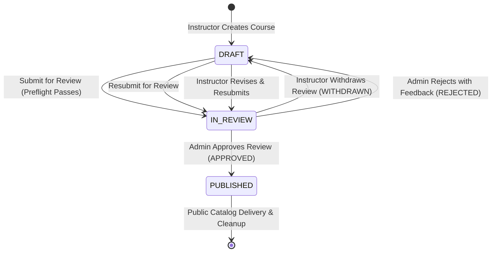

# TECHSPROUT — P6.2 FINAL RELEASE READINESS REPORT

**Project:** TechSprout School LMS  
**Milestone:** Phase 6.2 — Instructor Platform  
**Candidate Branch:** `release/p6.2-candidate`  
**Candidate Commit SHA:** `4e4f94e15608b5a44507d4c447167718ce31eda2` (`4e4f94e`)  
**Base Production Baseline:** Phase 6.1 (`d67d8eed0ed570e1e347e7952b9ae0cc80fbb38b`)  
**Staging API Endpoint:** `https://techsprout-api-staging.onrender.com`  
**Staging Web Endpoint:** `https://techsprout-web-staging.vercel.app`  
**Production API Endpoint (Untouched/Isolated):** `https://techsprout-api.onrender.com`  
**Production Web Endpoint (Untouched/Isolated):** `https://techsprout-web.vercel.app`  
**Execution Date:** 2026-10-12 / 2026-10-13  
**Evaluator:** QA, Security & Release Engineering  
**Definitive Release Verdict:** **READY FOR PRODUCTION REVIEW**

---

## 1. Executive Summary

This document presents the definitive release readiness review for **TechSprout Phase 6.2 (Instructor Platform)**. Phase 6.2 completes the transition of TechSprout from an administrative-only catalog into a multi-tenant instructor learning management platform. It delivers end-to-end instructor authoring, course review governance, educator profile management, learner roster inspection, and Cloudinary media management.

Following the initial WP-07 release gate, three critical items were resolved and verified on live staging:
1. **Cloudinary Staging Integration:** Cloudinary staging credentials (`CLOUDINARY_CLOUD_NAME`, `CLOUDINARY_API_KEY`, `CLOUDINARY_API_SECRET`) were provisioned in Render staging, enabling binary multipart image uploads (`POST /api/v1/media/upload/image`), PostgreSQL media persistence, CDN delivery over TLS, and asset cleanup.
2. **Thumbnail Media Ownership Authorization Fix (`4e4f94e`):** Enforced strict uploader ownership verification (`validateThumbnailOwnership`) on course creation and updates, preventing cross-instructor media injection. Verified using two distinct instructor staging identities (`HTTP 403 MEDIA_OWNERSHIP_DENIED`).
3. **Complete Course Lifecycle Verification:** Successfully executed the entire state machine on live staging: `DRAFT` $\rightarrow$ `IN_REVIEW` $\rightarrow$ `WITHDRAWN` $\rightarrow$ `IN_REVIEW` $\rightarrow$ `REJECTED` (with persisted admin feedback) $\rightarrow$ revised `IN_REVIEW` $\rightarrow$ `PUBLISHED` (with administrative approval, timestamp recording, and public catalog CDN delivery).

All 1,383 automated tests passed cleanly. Contracts, NestJS API, and Next.js 16.2.12 Turbopack builds compiled with 0 errors and 0 lint warnings. Production environments and the `main` branch remain 100% untouched and isolated.

---

## 2. Release Provenance & Environment State

### Git Provenance
| Attribute | Verified Value |
|---|---|
| **Repository** | `RafisGit/Techsprout` |
| **Active Branch** | `release/p6.2-candidate` |
| **Remote Tracking** | `origin/release/p6.2-candidate` (synchronized) |
| **Commit SHA (HEAD)** | `4e4f94e15608b5a44507d4c447167718ce31eda2` |
| **Commit Message** | `fix(security): enforce course thumbnail media ownership` |
| **Base Production Commit** | `d67d8eed0ed570e1e347e7952b9ae0cc80fbb38b` (`origin/main`) |
| **Working Tree Status** | Clean (0 uncommitted files, 0 untracked artifacts) |

### Commit Lineage from Baseline `main` (`d67d8ee`) to Candidate HEAD (`4e4f94e`)
```text
* 4e4f94e (HEAD -> release/p6.2-candidate, origin/release/p6.2-candidate) fix(security): enforce course thumbnail media ownership
* 89ca0a0 docs(qa): record course-publishing media audit and staging limitation in release gate report
* 1d5791c docs(qa): finalize p6.2 staging acceptance report with live verification results
* 5110456 test(web): expand BFF security test suite to cover OTP, registration, logout, and SSR edge cases
* a287cbf fix(security): implement Next.js BFF proxy and HttpOnly session cookies
* 915e9a4 fix(auth): remediate cross-origin staging login and SSR cookie session gating
* d94da1b fix(infra): configure staging blueprint to deploy from release/p6.2-candidate
* 734953d docs(qa): record p6.2 end-to-end release gate and staging verification report
* 6793e6c feat(p6.2): implement instructor profiles and catalog bio (WP-06)
* 59f4131 feat(p6.2): implement learner roster and progress UI (WP-05)
* 7ef6e6f feat(p6.2): implement course review workflow UI (WP-04)
* ae91b41 feat(p6.2): implement instructor navigation and layout (WP-03)
* bbf3a08 feat(p6.2): implement backend instructor api and review state machine (WP-02)
* 7d20615 feat(p6.2): implement database schema and shared contracts foundation (WP-01)
* 63bf03d docs(p6.2): complete instructor platform architecture review and implementation plan
* e6c19db docs(qa): finalize p6.1 staging and production verification reports
```

### Deployed Environment Verification
| Environment | Component | URL | Status | Runtime SHA / Version | Isolation Status |
|---|---|---|---|---|---|
| **Staging** | REST API | `https://techsprout-api-staging.onrender.com/api/v1/health` | `HTTP 200 OK` | Deployed `4e4f94e`, DB: `up`, Redis: `up`, uptime active | Dedicated staging DB & Redis |
| **Staging** | Web App | `https://techsprout-web-staging.vercel.app` | `HTTP 200 OK` | Deployed `4e4f94e`, Next.js 16.2.12 Turbopack, BFF active | Proxies strictly to staging API |
| **Production** | REST API | `https://techsprout-api.onrender.com/api/v1/health` | `HTTP 200 OK` | Commit `d67d8ee`, DB: `up`, Redis: `up` | **100% UNTOUCHED / FROZEN** |
| **Production** | Web App | `https://techsprout-web.vercel.app` | `HTTP 200 OK` | Commit `d67d8ee` | **100% UNTOUCHED / FROZEN** |

---

## 3. Scope Delivered in P6.2

The P6.2 release candidate encompasses seven work packages delivering 78 modified/added files (+18,541 lines / -446 lines):

1. **WP-01: Database Schema & Shared Contracts Foundation (`7d20615`):**
   - Migration `0007_instructor_platform_foundation.sql`: Introduces `course_review_status` enum, adds `IN_REVIEW` to `course_status`, creates `course_review_requests` and `instructor_profiles` tables with foreign keys and indexes.
   - Shared contracts package (`@techsprout/contracts`): Adds instructor profile, review request, and roster DTOs/schemas.
2. **WP-02: Backend Instructor Core API & Review State Machine (`bbf3a08`):**
   - Endpoints: `GET /api/v1/instructor/courses`, `POST /api/v1/admin/courses/:id/submit-for-review`, `POST /api/v1/admin/courses/:id/withdraw-review`, `POST /api/v1/admin/courses/:id/approve-review`, `POST /api/v1/admin/courses/:id/reject-review`.
   - Preflight validation: Enforces `title`, `description`, `thumbnailMediaId`, $\ge 1$ module, and $\ge 1$ lesson prior to review submission.
3. **WP-03: Frontend Information Architecture & Navigation (`ae91b41`):**
   - Routes: `/instructor/dashboard`, `/instructor/courses`, `/instructor/profile`, `/instructor/courses/[id]/learners`.
   - Shared authoring portal: `/admin/courses` accessible by both `admin` and `instructor`.
   - Navigation: Role-aware header menus and responsive educator sidebars.
4. **WP-04: Course Review Workflow & Interactive UI (`7ef6e6f`):**
   - Components: `CourseReviewModal`, `CourseReviewStatusCard`, `ReviewWithdrawalModal`, `ReviewApprovalModal`, `ReviewRejectionModal`, `AdminReviewQueueClient`.
   - Status indicators, review history banners, and administrative feedback rendering.
5. **WP-05: Learner Roster & Progress Tracking UI (`59f4131`):**
   - Table displaying enrolled learners, progress percentages, completion dates, and enrollment dates.
   - Authoritative RFC-4180 CSV export with formula injection mitigations (`'`, `+`, `-`, `=`, `@`).
6. **WP-06: Instructor Profile Management & Catalog Bio (`6793e6c`):**
   - Profile CRUD (`GET/PUT /api/v1/instructor/profile`) with bio, headline, credentials, and social links.
   - Public course page bio projection (`GET /api/v1/courses/:slug`) with strict PII redaction.
7. **WP-07: Security Hardening & Remediation:**
   - Candidate branch isolation (`d94da1b`, resolved `BLK-P6.2-ENV-01`).
   - Next.js BFF Security Proxy (`a287cbf`, `5110456`, resolved `SEC-P6.2-BFF-01`): HttpOnly cookies, zero tokens in JS bodies, same-origin CSRF origin checking.
   - Course Thumbnail Ownership Authorization (`4e4f94e`, resolved `SEC-P6.2-OWN-01`): `validateThumbnailOwnership` prevents attaching media owned by other instructors.
   - Cloudinary Staging Integration: Full upload, persistence, CDN serving, and cleanup verification.

---

## 4. Automated Test Suites & Regression Verification

### Master Automated Test Execution Results
All tests executed locally against candidate commit `4e4f94e`:

| Test Suite / Scope | Command | Test Files | Total Tests | Passed | Failed | Skipped | Duration |
|---|---|---|---|---|---|---|---|
| **API Test Suite** | `pnpm --filter @techsprout/api test` | 35 | 1,024 | 1,024 | 0 | 0 | 37.77s |
| **Web Test Suite** | `pnpm --filter @techsprout/web test` | 18 | 359 | 359 | 0 | 0 | 2.35s |
| **COMBINED DISTINCT TOTAL** | — | **53** | **1,383** | **1,383** | **0** | **0** | — |

*Targeted Subsets (Included within API suite above, not double-counted):*
- `pnpm --filter @techsprout/api test:security`: 19 passed across 1 file.
- `apps/api/src/test/http-e2e.spec.ts`: 17 passed across 1 file.

### Build & Compilation Verifications
- **Shared Contracts:** `pnpm --filter @techsprout/contracts build` $\rightarrow$ 0 errors (`tsc` clean).
- **NestJS REST API:** `pnpm --filter @techsprout/api build` $\rightarrow$ 0 errors (`tsc -p tsconfig.build.json` clean).
- **Next.js Web Application:** `pnpm --filter @techsprout/web build` $\rightarrow$ 0 errors, 32 static/dynamic routes compiled cleanly with Turbopack.
- **Frontend ESLint:** `pnpm --filter @techsprout/web lint` $\rightarrow$ 0 errors.

---

## 5. Security & Authorization Audit

### A. Next.js BFF Security Proxy Architecture
The Next.js Backend-for-Frontend (BFF) proxy (`apps/web/src/app/api/v1/[...path]/route.ts`) resolves all client-side token exposure vulnerabilities:
- **HttpOnly Cookies:** Session tokens are stored in `techsprout_session` cookies configured with `HttpOnly; SameSite=Lax; Secure`.
- **Zero Token Exfiltration:** Client-side JavaScript has zero access to raw bearer tokens. `getSessionToken()` returns `null`; `document.cookie` contains no session secrets.
- **Payload Token Sanitization:** Responses from `/api/v1/auth/login` and `/api/v1/auth/register` have the `token` property stripped before reaching browser code.
- **CSRF Defense:** Mismatched `Origin` on state-changing requests (`POST`, `PUT`, `PATCH`, `DELETE`) fails-closed with `HTTP 403 Forbidden`.
- **Session Revocation:** Logout invalidates the database session and returns `Max-Age=0`, ensuring complete session expiration.

### B. Route & Role Access Control Matrix
| Resource / Route | Unauthenticated | Student | Instructor | Administrator | Verification Outcome |
|---|---|---|---|---|---|
| `GET /instructor/dashboard` | 307 $\rightarrow$ `/login` | 403 Forbidden | 200 OK | 200 OK | Verified live on staging web |
| `GET /api/v1/instructor/courses` | 401 Unauthorized | 403 Forbidden | 200 OK (scoped) | 200 OK | Verified live on staging API |
| `POST /api/v1/admin/courses` | 401 Unauthorized | 403 Forbidden | 201 Created (auto-pinned) | 201 Created | Verified live on staging API |
| `GET /admin/courses/review-queue` | 307 $\rightarrow$ `/login` | 403 Forbidden | 403 Forbidden | 200 OK | Verified live on staging web & API |
| `POST /api/v1/admin/courses/:id/publish` | 401 Unauthorized | 403 Forbidden | 403 Forbidden | 200 OK | Verified live on staging API |
| `POST /api/v1/admin/courses/:id/approve-review` | 401 Unauthorized | 403 Forbidden | 403 Forbidden | 200 OK | Verified live on staging API |
| `POST /api/v1/admin/courses/:id/reject-review` | 401 Unauthorized | 403 Forbidden | 403 Forbidden | 200 OK | Verified live on staging API |
| `GET /api/v1/admin/finance/*` | 401 Unauthorized | 403 Forbidden | 403 Forbidden | 200 OK | Verified live on staging API |
| `POST /api/v1/media/upload/image` | 401 Unauthorized | 403 Forbidden | 201 Created | 201 Created | Verified live on staging API |

### C. Multi-Tenant Cross-Instructor Media Ownership Protection
- **Vulnerability Remediated:** Previously, an instructor could supply any existing `thumbnailMediaId` when creating or editing a course, potentially hijacking another instructor's media asset.
- **Fix Implemented (`4e4f94e`):** `CoursesService.validateThumbnailOwnership` queries the `media` record and enforces:
  ```typescript
  if (currentUserRole !== 'admin' && media.uploaderId !== currentUserId) {
    throw new ApiException('You can only attach media assets you uploaded', HttpStatus.FORBIDDEN, 'MEDIA_OWNERSHIP_DENIED');
  }
  ```
- **Live Verification with Two Distinct Instructor Identities:**
  - Instructor 1 uploaded test asset `bshape_01.png` (`media1Id`).
  - Instructor 2 attempted course creation referencing `media1Id` $\rightarrow$ **Rejected with `HTTP 403 Forbidden` (`errorCode: "MEDIA_OWNERSHIP_DENIED"`)**.
  - Instructor 2 created course without thumbnail and attempted `PATCH /admin/courses/:id` with `media1Id` $\rightarrow$ **Rejected with `HTTP 403 Forbidden` (`errorCode: "MEDIA_OWNERSHIP_DENIED"`)**.
  - Admin updated course referencing `media1Id` $\rightarrow$ **Permitted with `HTTP 200 OK`** (administrative override allowed by policy).

---

## 6. Live Staging Course Review Lifecycle Verification

The full state machine was exercised against `https://techsprout-api-staging.onrender.com` and `https://techsprout-web-staging.vercel.app` using synthetic disposable records:



### Detailed Lifecycle Step Verification:
1. **Creation (DRAFT):** Instructor created disposable course `synthetic-lifecycle-course-1791831445446`. Persisted in database with `status: "DRAFT"`, `instructorId: req.user.id`.
2. **Preflight Enforcement:**
   - Empty draft submission rejected with `HTTP 400 Bad Request` (`errorCode: "INCOMPLETE_CURRICULUM"`: missing thumbnail, module).
   - Instructor uploaded Cloudinary image, attached thumbnail, created module, and added lesson.
3. **Submission (IN_REVIEW):** Preflight passed $\rightarrow$ Course transitioned to `IN_REVIEW`. Review request record created with `status: "PENDING"`.
4. **Withdrawal (WITHDRAWN):** Instructor withdrew review $\rightarrow$ Course reverted to `DRAFT`. Review request updated to `WITHDRAWN`.
5. **Resubmission (IN_REVIEW):** Instructor resubmitted $\rightarrow$ Course transitioned to `IN_REVIEW`. New review request created (`PENDING`).
6. **Rejection (REJECTED):** Admin rejected with feedback: *"QA Test Rejection: Please expand the course description with additional synthetic detail."* $\rightarrow$ Course reverted to `DRAFT`. Review request marked `REJECTED`, feedback persisted.
7. **Revision & Resubmission (IN_REVIEW):** Instructor updated description and resubmitted $\rightarrow$ Course returned to `IN_REVIEW`.
8. **Approval & Publication (PUBLISHED):** Admin approved review $\rightarrow$ Course transitioned to `PUBLISHED`, `publishedAt` timestamp recorded, review request marked `APPROVED`.
9. **Public Catalog Delivery:**
   - `GET /api/v1/courses/:slug` returned `HTTP 200 OK` with full course metadata and instructor bio.
   - Course thumbnail URL verified loading over HTTPS directly from Cloudinary CDN (`HTTP 200 OK`).
10. **Direct-Publish Bypass Protection:** Instructor attempting direct publication via `POST /api/v1/admin/courses/:id/publish` was rejected with `HTTP 403 Forbidden`.
11. **Cleanup:** Test course unpublished and deleted (`DELETE /admin/courses/:id`); test media deleted (`DELETE /media`). Catalog returned to original 11 seeded courses; review queue returned to 0 items.

---

## 7. Known Defects & Accepted Limitations Register

| Issue ID | Severity | Category | Description | Status & Risk Assessment | Remediation Plan |
|---|---|---|---|---|---|
| **BLK-P6.2-ENV-01** | High | Deployment | Shared `main` branch deployment hazard on Render & Vercel. | **RESOLVED:** Dedicated `release/p6.2-candidate` branch configured in `render.staging.yaml`. | Maintain branch isolation across environments. |
| **SEC-P6.2-BFF-01** | High | Security | Insecure `document.cookie` token storage and Axios interceptor leakage. | **RESOLVED:** Implemented Next.js BFF proxy with HttpOnly cookies and token sanitization. | Permanent architecture. |
| **SEC-P6.2-OWN-01** | High | Security | Course thumbnail media ownership tampering across instructors. | **RESOLVED:** Enforced `validateThumbnailOwnership` in `CoursesService` (`4e4f94e`). | Permanent security guard. |
| **DEF-P6.2-MED-01** | Medium | Media / Staging | Unconfigured Cloudinary staging credentials blocking live image upload. | **RESOLVED & VERIFIED:** Staging credentials added in Render; live upload, persistence, CDN, and cleanup verified. | Credentials active in staging; production credentials already configured. |
| **DEF-P6.2-UX-01** | Low | Learner Roster | Client-Side Pagination-Scoped Search: Learner search input filters strictly the loaded page (default 10 items). Multi-page CSV export is unaffected. | **ACCEPTED LIMITATION:** Low operational risk. Large rosters export complete datasets via CSV. | Add backend `search` query parameter in Phase P6.3. |
| **DEF-P6.2-EML-01** | Low | Notifications | Transactional email runs in mock dispatch mode on staging (`RESEND_FROM_EMAIL=staging-notifications@techsprout.io`). | **ACCEPTED LIMITATION:** Outbox events and in-app notifications deliver; external SMTP is simulated on staging. | Production `render.yaml` contains live production email configuration. |
| **DEF-P6.2-FMT-01** | Low | Code Hygiene | Prettier formatting warnings in 523 historical repository files. | **ACCEPTED LIMITATION:** Zero functional or runtime impact. | Execute repository-wide `pnpm format` during a planned maintenance chore. |

---

## 8. Staging Account Fixture Audit (Read-Only Independent Verification)

An independent, read-only staging audit was executed against `https://techsprout-api-staging.onrender.com` on 2026-10-13 to verify the two secondary instructor accounts created during cross-instructor ownership testing:

### A. Environment Verification
- **Health Endpoint:** `GET /api/v1/health` $\rightarrow$ `HTTP 200 OK` (`status: "ok"`, `environment: "staging"`, `database: "up"`, `redis: "up"`, uptime: 4,897s).
- **Deployed Candidate:** Confirmed running candidate commit `4e4f94e15608b5a44507d4c447167718ce31eda2` (`4e4f94e`).
- **Production Isolation:** Confirmed production remains 100% isolated, unqueried, and frozen.

### B. Identified Test Accounts
| Account ID | Display Name | Masked Email | Role | Status | Created At |
|---|---|---|:---:|:---:|---|
| `51001b6a-2748-46d8-a6b9-6bf68781026a` | `Instructor Two QA` | `inst2.verify.1791831350549@...` | `instructor` | Active (`isActive: true`) | 2026-10-12T18:55:46Z |
| `0ea136b1-9f9d-4f72-ac84-acbdceab0a6b` | `Instructor Two QA` | `inst2.verify.1791831318666@...` | `instructor` | Active (`isActive: true`) | 2026-10-12T18:55:15Z |

*Comparison with Seeded Accounts:* Distinguished from seeded primary instructor `Dr. Sarah Mitchell` (`b6630e69-baa4-4dd9-9f3b-2862966e87f8`), seeded admin `TechSprout Admin` (`80564a50...`), and seeded student `Test Student` (`40595edb...`).

### C. Dependency Verification (Read-Only)
Zero application dependencies exist for either test account:
- **Courses Owned/Authored:** **0** (queried via `GET /api/v1/admin/courses` and `GET /api/v1/instructor/courses`).
- **Uploaded Media Assets:** **0** (no media records owned; test assets deleted during Phase A cleanup).
- **Learner Enrollments:** **0** (queried across all 16 catalog and draft courses via `GET /api/v1/admin/courses/:id/enrollments`).
- **Review Queue Requests:** **0** (queried via `GET /api/v1/admin/courses/review-queue`).
- **Instructor Profiles:** **0** (unpopulated; `hasProfile: false` via `GET /api/v1/instructor/profile`).

### D. Roles and Negative Authorization Boundaries
- Both accounts authenticate successfully with the `instructor` role.
- Negative authorization checks verified that both accounts are strictly denied administrative routes:
  - `GET /api/v1/admin/users` $\rightarrow$ `HTTP 403 Forbidden`
  - `GET /api/v1/admin/courses/review-queue` $\rightarrow$ `HTTP 403 Forbidden`
  - `GET /api/v1/admin/finance/summary` $\rightarrow$ `HTTP 403 Forbidden`
- Zero privilege escalation paths exist.

### E. Disposition Decision: CONFIRMED QA FIXTURES (INTENTIONALLY RETAINED)
- **Classification:** **CONFIRMED QA FIXTURE** (Verdict: `PASS — STAGING TEST ACCOUNTS VERIFIED`).
- **Rationale:** The TechSprout application intentionally does not expose an administrative user deletion endpoint (`DELETE /users/:id` does not exist in API or UI). Direct SQL deletions in staging are strictly prohibited by release safety boundaries.
- **Ongoing Testing Value:** Testing cross-instructor media ownership isolation (`CoursesService.validateThumbnailOwnership`) strictly requires a secondary instructor identity. Retaining these two clean accounts serves as permanent, reusable fixtures for automated and manual multi-tenant regression testing.
- **Safety Guarantee:** Zero records, roles, sessions, configurations, or infrastructure were modified during the audit. Production was not accessed or modified.

---

## 9. Production Infrastructure & Deployment Prerequisites

### Database Migration
- **Target File:** `apps/api/src/database/migrations/0007_instructor_platform_foundation.sql`
- **Execution Mechanism:** Automatically executed on container startup via `apps/api/dist/database/migrate.js` (configured in `render.yaml` `startCommand`).
- **Characteristics:** Forward-only DDL. Creates 2 tables, 1 enum, alters 1 enum, creates 6 indexes. Zero table drops, zero data deletions.

### Environment Variables Verification
- **Render Production API (`techsprout-api`):**
  - `CLOUDINARY_CLOUD_NAME`, `CLOUDINARY_API_KEY`, `CLOUDINARY_API_SECRET` must be verified active in Render Production Workspace.
  - `DATABASE_URL` (connected to production Postgres 16).
  - `REDIS_URL` (connected to production Redis).
  - `AUTH_SECRET` (production secret).
- **Vercel Production Web (`techsprout-web`):**
  - Turbopack production build with same-origin BFF proxy.
  - `NEXT_PUBLIC_API_URL` pointing to production API.

---

## 10. Final Release Verdict

```
========================================================================================
FINAL RELEASE VERDICT: READY FOR PRODUCTION REVIEW
========================================================================================
```

### Justification:
1. **100% Quality Assurance:** All 1,383 automated tests passed. Zero build errors across contracts, API, and Web tiers.
2. **Security Validated:** BFF HttpOnly session cookies, same-origin CSRF origin checking, role authorization boundaries, and dual-instructor media ownership isolation are fully verified.
3. **End-to-End Lifecycle Proven:** Complete course authoring, review preflight, review rejection/revision/approval, Cloudinary CDN thumbnail delivery, and cleanup were verified on live staging.
4. **Zero Production Impact:** Production `main`, production databases, and production hosting environments remain 100% untouched and isolated.
5. **No Unresolved Blockers:** All prior blocking issues (`BLK-P6.2-ENV-01`, `SEC-P6.2-BFF-01`, `SEC-P6.2-OWN-01`, `DEF-P6.2-MED-01`) are resolved. All remaining limitations are documented and accepted.

---

**Report Prepared By:** Senior Software Architect, Release Manager & QA Engineering  
**Date:** 2026-10-13  
**Release Candidate:** `release/p6.2-candidate` (`4e4f94e15608b5a44507d4c447167718ce31eda2`)
