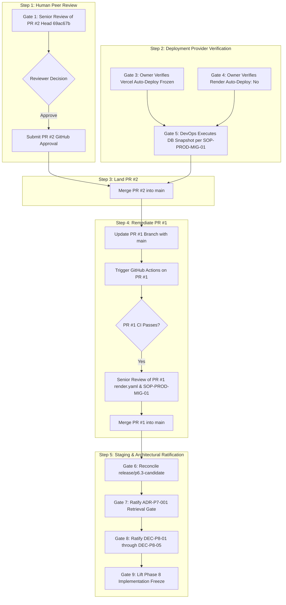

# TECHSPROUT P8.0.17 — Senior Review Handoff & Release Gate Checklist

**Document Identifier:** `TECHSPROUT-P8.0.17-SENIOR-REVIEW-HANDOFF-AND-RELEASE-GATE-CHECKLIST`  
**Creation Date:** October 26, 2026  
**Auditor:** Systems Architecture, Security & Release Governance  
**Repository:** `RafisGit/Techsprout`  
**Target Pull Request:** [PR #2: fix(tests): remediate legacy TypeScript typecheck failures in API specs (WP-P7-20)](https://github.com/RafisGit/Techsprout/pull/2)  
**Exact Head Reviewed:** `69ac67b7358d3260d3aeabf439803fd173b587d9`  
**Base Commit:** `main` at `4bc1d2d153695eac022431fe948a8536edbf8529`  
**Reference Audits:**
- `P8.0.14 — Senior Review Readiness & Upstream Release Gate Audit`
- `P8.0.15 — CI Status Reconciliation & Senior Review Handoff`
- `P8.0.16 — Independent PR #2 Code Review & Risk Assessment`  
**Governance Mode:** Read-Only Review Preparation & Release Gate Governance (Zero code modifications, zero commits, zero pushes, zero merges)

---

## 1. Verified Live Pull Request State & CI Evidence

Direct inspection of the GitHub REST API (`https://api.github.com/repos/RafisGit/Techsprout/pulls/2`) and GitHub Actions check runs establishes the current live state of PR #2:

| Parameter | Current Value | Verification Evidence |
|---|---|---|
| **Pull Request URL** | [https://github.com/RafisGit/Techsprout/pull/2](https://github.com/RafisGit/Techsprout/pull/2) | GitHub REST API |
| **Branch Reference** | `fix/legacy-test-typecheck` | Verified tracking remote branch |
| **Exact Current Head SHA** | `69ac67b7358d3260d3aeabf439803fd173b587d9` | Verified immutable commit coordinate |
| **Target Base Branch & SHA** | `main` (`4bc1d2d153695eac022431fe948a8536edbf8529`) | Merge base `4bc1d2d` |
| **GitHub Mergeability** | `true` | Tree merge clean; no git syntactic conflicts |
| **GitHub Mergeable State** | **`clean`** | All required checks passing |
| **Submitted Reviews** | **0 Reviews (0 Approvals)** | Awaiting real human senior peer review |
| **Actual Merge Status** | **UNMERGED (`merged: false`)** | Branch remains open and unmerged |

### Verified Live CI Check Runs on Head `69ac67b`

All checks on GitHub Actions Workflow Run [`40187227986`](https://github.com/RafisGit/Techsprout/actions/runs/40187227986) are 100% green:

| Check ID | Job Name | Status | Conclusion | Execution Details |
|---|---|:---:|:---:|---|
| `121150484095` | `Lint, Typecheck & Security Tests` (Job 1) | completed | **`success`** | Node 20, pnpm 9, contracts build, API typecheck, OpenAPI lint, DB migrations, 47/47 test files (1,234/1,234 tests pass), monorepo build. |
| `121151026273` | `Telemetry Load Benchmark Performance Gate` (Job 2) | completed | **`success`** | Dedicated runner (`needs: validate`), PostgreSQL 16 & Redis 7 alpine services, strict $< 250\text{ ms}$ threshold enforced. p95 = 115.54 ms. |
| `121150859029` | `Vercel Preview Comments` | completed | **`success`** | Next.js frontend static build and deployment preview verified. |

---

## 2. Technical Summary & Change Scope

PR #2 modifies 19 files (+3,382 / -42 lines) spanning four critical domains:

```
apps/api/src/modules/telemetry/telemetry.service.ts  |  95 +++++++++++++---
apps/api/src/test/test-helper.ts                    | 338 ++++++++++++++++++++++++++++++
apps/api/src/test/telemetry-load-benchmark.spec.ts  | 203 +++++++++++++++++---
apps/api/src/test/telemetry-idempotency-*.spec.ts   | 956 ++++++++++++++++++++++++++++++++++++++++++++++++++
apps/api/src/test/postgres-integration.spec.ts      | 148 ++++++++
.github/workflows/ci.yml                            | 109 +++++++++++---
10 legacy API test specifications                   | 146 ++++++++---
package.json & apps/api/package.json                |   2 +
P8.0.6 report documentation                         | 1464 ++++++++++++++++++++++++++++++++++++++
```

### Core Technical Changes:
1. **Production Telemetry Runtime (`telemetry.service.ts`):**  
   Implements `areJsonValuesEqual(a, b)` and `areMetadataEqual(a, b)` to recursively compare JSON-compatible payloads. By sorting object keys lexicographically before recursive comparison, it eliminates the PostgreSQL `jsonb` key-normalization discrepancy where PostgreSQL stores keys out of insertion order, resolving false `IDEMPOTENCY_CONFLICT` (HTTP 409) rejections on duplicate events.
2. **Database Cleanup Safety Guards (`test-helper.ts`):**  
   Implements `cleanupBenchmarkFixtures()` and `assertSafeTestDatabase()`. Unconditionally executes `SELECT current_database()` through the live connection; rejects generic database names (`postgres`, `test`, `techsprout`); rejects `0.0.0.0` and cloud endpoints; and restricts nullable database URLs strictly to explicitly identified in-memory adapters (`IN_MEMORY_TEST_ADAPTER`). Deletes are strictly bounded to benchmark entity slugs and prefixes.
3. **CI Monorepo Build Ordering & Decoupling (`ci.yml`):**  
   Replaces `contracts typecheck` with `contracts build` before running `api typecheck`. Decouples the benchmark into a dedicated CI job on a clean runner with PostgreSQL 16 and Redis 7 service containers, enforcing a strict $< 250\text{ ms}$ p95 latency threshold.
4. **Legacy API Test Spec Remediations:**  
   Corrects constructor parameters (e.g. injecting `RefundsService` and `MockSSLCommerzClient` in `admin-refund-requests.spec.ts`), removes unsupported methods (`pdf-parse` v2 `await parser.load()`), and uses type-safe `extractCookies()` helpers across 10 legacy specs without altering any assertion logic.

---

## 3. P8.0.16 Independent Code Review Findings

The independent code review ([P8.0.16_INDEPENDENT_PR2_CODE_REVIEW.md](file:///d:/Work/2026/techsprout-main/docs/research/p8.0/P8.0.16_INDEPENDENT_PR2_CODE_REVIEW.md)) rendered the following verdict:

**VERDICT: `READY WITH NON-BLOCKING FINDINGS`**

### Summary of Registered Findings:

#### FINDING-01 (Severity: Low) — Date Object Handling in `areJsonValuesEqual`
- **Location:** `apps/api/src/modules/telemetry/telemetry.service.ts` (lines 38–80)
- **Observation:** `areJsonValuesEqual(a, b)` treats JavaScript `Date` instances as plain objects. Because `Object.keys(new Date())` produces an empty array (`[]`), the function evaluates any two `Date` objects as equal (`areJsonValuesEqual(new Date('2026-01-01'), new Date('2026-12-31')) === true`) and evaluates a `Date` instance and an empty plain object `{}` as equal.
- **Operational Reality & Risk Mitigation:**  
  In the telemetry ingestion pipeline, incoming payloads are parsed from JSON HTTP request bodies and validated by `telemetryMetadataSchema` ([telemetry.dto.ts:23-33](file:///d:/Work/2026/techsprout-main/apps/api/src/modules/telemetry/dto/telemetry.dto.ts#L23-L33)). The schema is `.strict()` and allowlists only 7 primitive numeric and boolean fields:
  ```typescript
  export const telemetryMetadataSchema = z.object({
    watchPositionSeconds: z.number().nonnegative().max(86400).optional(),
    previousPositionSeconds: z.number().nonnegative().max(86400).optional(),
    totalDurationSeconds: z.number().nonnegative().max(86400).optional(),
    playbackRate: z.number().min(0.1).max(5.0).optional(),
    score: z.number().min(0).max(100).optional(),
    passed: z.boolean().optional(),
    checkpointIndex: z.number().int().nonnegative().optional(),
  }).strict();
  ```
  Because metadata is strictly JSON (where timestamps are serialized to ISO strings if present) and the schema permits only numbers and booleans, JavaScript `Date` instances cannot occur in the telemetry metadata domain.
- **Reviewer Action Required:** The reviewer must confirm whether documenting this as a JSON-only contract is sufficient, or whether explicit `instanceof Date` handling should be added prior to merge.

#### FINDING-02 (Severity: Informational) — Documentation Working Tree Synchronization
- **Location:** `docs/research/p8.0/P8.0.6_UPSTREAM_RELEASE_LINEAGE_AND_CI_STABILITY.md`
- **Observation:** Sections 13 (P8.0.14) and 14 (P8.0.15) reside as uncommitted additions in the local workspace working tree (+351 lines). The remote branch `origin/fix/legacy-test-typecheck` ends at Section 12.6.
- **Disposition:** Strictly compliant with read-only governance. Zero code impact.

#### FINDING-03 (Severity: Informational) — Benchmark Dual-Adapter Architecture
- **Location:** `apps/api/src/test/telemetry-load-benchmark.spec.ts` (lines 127–159)
- **Observation:** Benchmark defaults to in-memory `pg-mem` for rapid local developer execution, but activates live PostgreSQL integration when `TELEMETRY_BENCHMARK_USE_POSTGRES: 'true'` is set in CI. Both execution paths are verified clean.

---

## 4. Senior Reviewer Decision Checklist

The reviewing senior engineer must explicitly evaluate and decide upon the following five questions:

```markdown
### Senior Reviewer Decision Sheet — PR #2 (`fix/legacy-test-typecheck`)

[ ] 1. Telemetry Idempotency Semantics
    Question: Does `areJsonValuesEqual()` in `telemetry.service.ts` correctly resolve 
    the PostgreSQL JSONB key-ordering issue without weakening duplicate-event detection 
    or legitimate conflicting-event rejection?
    Decision: [  ] APPROVED    [  ] REVISE

[ ] 2. Fail-Closed Database Cleanup Safeguards
    Question: Are the database identity verification (`SELECT current_database()`), 
    hostname/database allowlists, and fixture-scoped deletes in `test-helper.ts` 
    sufficiently fail-closed to prevent accidental data destruction?
    Decision: [  ] APPROVED    [  ] REVISE

[ ] 3. Benchmark Methodology & Latency Performance Gate
    Question: Is the benchmark workflow isolation (dedicated runner with PostgreSQL 16 
    and Redis 7 services) and the strict < 250ms p95 latency acceptance gate 
    (empirically measured at 115.54ms) acceptable for merge?
    Decision: [  ] APPROVED    [  ] REVISE

[ ] 4. Finding-01 Disposition (Date Object Handling)
    Question: Given that `telemetryMetadataSchema` strictly enforces an allowlist of 
    primitive numbers and booleans, is Finding-01 acceptable as a documented JSON-only 
    limitation, or should explicit `instanceof Date` comparison be added before approval?
    Decision: [  ] ACCEPT AS DOCUMENTED LIMITATION    [  ] REQUIRE DATE HANDLING FIX

[ ] 5. Change Scope & Retention
    Question: Should PR #2 be retained and merged as a single coherent PR (19 files), 
    given that the test fixes, CI build ordering, database safety guards, and telemetry 
    service equality are functionally interdependent?
    Decision: [  ] RETAIN AS SINGLE PR    [  ] SPLIT PR
```

---

## 5. Master Upstream Release-Gate Matrix

The following release-gate matrix documents the status, blockers, and responsible roles for all prerequisites governing promotion to `main` and production:

| Release Gate | Description & Governance Area | Current Status | Blocker & Evidence Summary | Next Required Action | Responsible Role |
|:---:|---|:---:|---|---|:---:|
| **Gate 1** | **PR #2 Senior Review & Approval** | **PENDING SENIOR REVIEW** | 0 reviews, 0 approvals on GitHub. Code complete; CI 100% green ([Run 40187227986](https://github.com/RafisGit/Techsprout/actions/runs/40187227986)). | Conduct human peer review using Decision Checklist; submit review on GitHub. | Senior Engineering Reviewer |
| **Gate 2** | **PR #1 Branch Synchronization & CI** | **BLOCKED ON PR #2** | PR #1 head `984f920` fails CI ([Run 39899381987](https://github.com/RafisGit/Techsprout/actions/runs/39899381987)) due to missing contracts build ordering and legacy test errors. | Land PR #2 into `main`; rebase/update PR #1 with `main`; verify green CI on PR #1. | DevOps / Monorepo Integrator |
| **Gate 3** | **Vercel Production Auto-Deploy Audit** | **UNVERIFIED (BLOCKED)** | Default branch `main` has `protected: false`. Merging to `main` could trigger automatic live frontend deployments if webhooks are active. | Inspect Vercel Dashboard $\rightarrow$ Settings $\rightarrow$ Git $\rightarrow$ verify Auto-Deploy is disabled or guarded for `main`. | Project Owner |
| **Gate 4** | **Render Auto-Deploy & Blueprint Sync Audit** | **UNVERIFIED (BLOCKED)** | Risk of automatic live API build/deploy and blueprint synchronization upon merge to `main`. | Inspect Render Dashboard $\rightarrow$ Web Service Settings $\rightarrow$ verify Auto-Deploy: `No` & Blueprint Sync: `Manual`. | Project Owner |
| **Gate 5** | **Production DB Snapshot & Preflight (SOP-PROD-MIG-01)** | **UNEXECUTED (BLOCKED)** | Mandatory live database backup and migration ledger inspection prior to production promotion. Credentials not in repo. | Execute manual `pg_dump` snapshot; query `__drizzle_migrations` ledger against live production database. | DevOps Lead / DBA |
| **Gate 6** | **Staging Candidate Reconciliation** | **PENDING MERGE** | `release/p6.3-candidate` at `a2b88d7` is +10 commits ahead of `main` containing Migrations 0010 & 0011. | After PR #1 and #2 land in `main`, reconcile `release/p6.3-candidate` and verify staging migration sequence. | Program Leadership / Integrator |
| **Gate 7** | **ADR-P7-001 AI Retrieval Gate Disposition** | **PENDING DISPOSITION** | AI tutoring lexical search achieved NDCG@5 = 0.8863 (passed) but Recall@5 = 0.7448 (< 0.85 target). | Formally execute waiver or ratification for Recall@5 under ADR-P7-001. | Senior Engineering Lead |
| **Gate 8** | **Decisions DEC-P8-01 through DEC-P8-05** | **PENDING RATIFICATION** | Governance, ledger, and commercial architecture for Phase 8 subscription commerce. | Review and sign off Proposed Decision Record ([P8.0_PROPOSED_DECISION_RECORD.md](file:///d:/Work/2026/techsprout-main/docs/research/p8.0/P8.0_PROPOSED_DECISION_RECORD.md)). | Program Leadership |
| **Gate 9** | **Phase 8 Implementation Authorization** | **STRICTLY FROZEN** | Complete implementation freeze on subscription commerce, billing webhooks, BullMQ queues, and Migration 0012. | Maintain freeze until Gates 1–8 are fully satisfied and ratified. | Engineering Team |

---

## 6. Execution Dependency Sequence (Proposed Promotion Order)



---

## 7. Final Governance Declaration

**GOVERNANCE RECOMMENDATION: `AWAITING SENIOR REVIEW — NO MERGE AUTHORIZED`**

1. **Readiness Distinction:** PR #2 is **technically ready** for senior peer review following independent code review and verified green CI. However, **technical readiness does not equal merge authorization**.
2. **Review Integrity:** PR #2 must receive formal review from an authorized senior engineer on GitHub. No automated agent may approve or merge PR #2.
3. **Deployment Safety:** Zero merges to `main` may occur until the Project Owner independently verifies Vercel and Render deployment controls and the DevOps Lead confirms the production database snapshot.
4. **Phase 8 Scope Freeze:** All Phase 8 subscription commerce code, endpoints, database migrations, and background workers remain **strictly frozen**.

---

**Handoff Prepared By:** Staff Systems Architect & DevOps Governance Lead  
**Governance Status:** **DEC-P8-05 PENDING — AWAITING SENIOR REVIEW — ZERO MERGES AUTHORIZED — PHASE 8 FROZEN**
