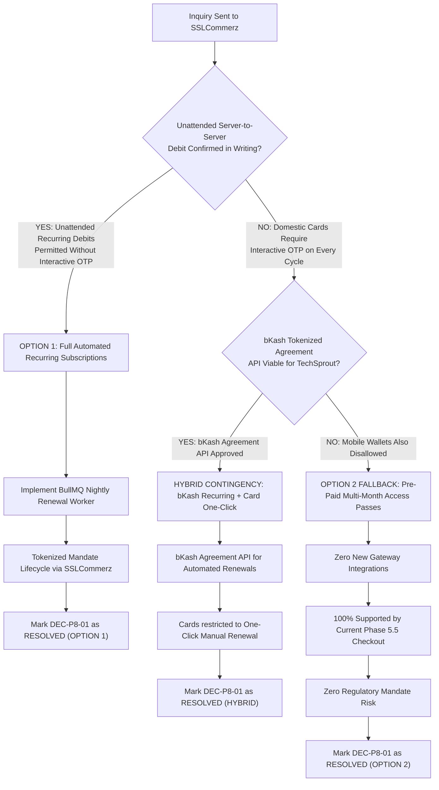

# TECHSPROUT P8.0 — SSLCOMMERZ RECURRING PAYMENT INQUIRY & VERIFICATION CHECKLIST
## Provider Due Diligence for Decision Item DEC-P8-01

**Document Identifier:** `TECHSPROUT-P8.0-MERCHANT-INQUIRY-CHECKLIST`  
**Milestone:** Phase 8.0 Decision Preparation (DEC-P8-01)  
**Date Prepared:** October 2026  
**Target Recipient:** SSLCommerz Merchant Operations & Technical Support (`support@sslcommerz.com`, `operation@sslcommerz.com`)  
**Designated Sender:** Finance Lead & Authorized Merchant Account Owner  
**Governance Status:** **DRAFT INQUIRY — STRICTLY PROHIBITED FROM TRANSMISSION WITHOUT FORMAL SIGN-OFF**

---

> [!CAUTION]
> **GOVERNANCE NOTICE: DO NOT TRANSMIT WITHOUT WRITTEN AUTHORIZATION**  
> This inquiry and verification checklist is prepared solely for internal review by TechSprout Senior Engineering Leadership, Product Governance, and Finance. **Do NOT send this email, submit a support ticket, or communicate with SSLCommerz account managers until the Finance Lead and Senior Engineering Lead explicitly authorize transmission.** Phase 8 implementation remains strictly frozen.

---

## 1. Executive Summary & Verification Context

### 1.1 Objective of DEC-P8-01
Decision **DEC-P8-01** determines whether TechSprout can proceed with **Option 1: Full Tokenized Recurring Subscriptions** or must fallback to **Option 2: Pre-Paid Multi-Month Access Passes** (or bKash Tokenized Agreements).

The core technical question is:
> *Can TechSprout's SSLCommerz merchant account execute automated, unattended, server-to-server recurring renewals on a monthly/annual schedule without requiring the student to complete an interactive OTP challenge on every billing cycle?*

### 1.2 Official Provider Documentation Baseline & Grounding

| Provider / Channel | Documented Capabilities (Public Documentation) | Merchant-Specific Capabilities Requiring Provider Confirmation | Source Reference & Verification Date |
|---|---|---|---|
| **SSLCommerz (Card / Multi-Channel)** | - Session API v4 (`gwprocess/v4/api.php`) for one-time checkout.<br>- Asynchronous IPN webhook callbacks.<br>- Order Validation API (`validationserverAPI.php` with `val_id`).<br>- Card Tokenization Vaulting with `user_refer` (AES-256-CBC encrypted JSON, 20+ chars, salt key).<br>- PCI-DSS Level 1 compliant token storage.<br>- Refund API (`val_id`, `recheck_id`). | - Tokenization feature activation on merchant `store_id` (disabled by default).<br>- Headless server-to-server Merchant-Initiated Transactions (MIT) without 3DS OTP on subsequent cycles.<br>- Bangladesh Bank e-mandate registration requirements & acquiring bank underwriting rules.<br>- Official recurring/subscription API endpoint specifications, parameters, and renewal webhooks. | Official Developer Portal: `https://developer.sslcommerz.com/` (Accessed: October 2026).<br>Existing Client: [`sslcommerz.client.ts`](file:///d:/Work/2026/techsprout-main/apps/api/src/modules/payments/sslcommerz.client.ts). |
| **bKash (Tokenized Checkout API v1.2.0)** | - Dedicated Agreement API (`POST /tokenized/checkout/create-agreement`).<br>- One-time user consent redirect (`bkashURL`) with OTP & PIN.<br>- Agreement finalization (`POST /tokenized/checkout/execute-agreement`) returning permanent `agreementID`.<br>- Programmatic server-to-server renewal charging (`POST /tokenized/checkout/payment`) using stored `agreementID` without student OTP or presence.<br>- Query and Cancel Agreement endpoints. | - Commercial merchant approval for Tokenized Checkout vs. standard checkout.<br>- Daily transaction volume ceilings and wallet balance failure retry policies.<br>- Merchant MDR (Merchant Discount Rate) for tokenized recurring debits. | Official bKash Developer Portal: `https://developer.bka.sh/` (Accessed: October 2026).<br>API Version: v1.2.0-beta Tokenized Checkout. |

---

## 2. Draft Merchant Support Inquiry

```text
To: support@sslcommerz.com, operation@sslcommerz.com
Cc: [FINANCE_LEAD_EMAIL], [ENGINEERING_LEAD_EMAIL]
Subject: [Merchant Inquiry] Technical Eligibility & API Specifications for Tokenized Recurring Billing / Subscriptions — TechSprout (Store ID: [MERCHANT_STORE_ID])
Importance: High

Dear SSLCommerz Technical Support & Merchant Operations Team,

TechSprout operates an online educational technology platform in Bangladesh, currently utilizing SSLCommerz for single-course transactional payments under Store ID: [MERCHANT_STORE_ID].

We are currently architecting an automated subscription and membership service (monthly and annual recurring billing) and require formal written clarification regarding your tokenization and recurring payment capabilities.

Could you please review and confirm the following four technical and commercial questions in writing:

========================================================================================
SECTION A: MERCHANT ACCOUNT ELIGIBILITY & TOKENIZATION ACTIVATION
========================================================================================
1. Is TechSprout's merchant profile ([MERCHANT_STORE_ID]) eligible for card tokenization (saved card / card-on-file)?
2. What specific commercial, KYC, or underwriting requirements must be fulfilled to enable tokenization on our Live merchant account?
3. What is the SLA or activation timeline once formal documentation is submitted?

========================================================================================
SECTION B: RECURRING RENEWALS & OTP / AUTHENTICATION (MIT vs. CIT)
========================================================================================
4. When a student subscribes, they complete an initial interactive 3D Secure / OTP verification on the SSLCommerz hosted gateway page. On subsequent recurring renewal cycles (e.g., 30 days later), can our server initiate an automated recurring debit (Merchant-Initiated Transaction) WITHOUT requiring the student to enter an OTP or visit a payment page?
5. If OTP-less recurring renewal is supported:
   a. Which domestic and international card networks (Visa, Mastercard, Amex) and acquiring banks in Bangladesh currently support this?
   b. Are there maximum per-transaction ticket limits mandated by Bangladesh Bank e-mandate directives for unattended recurring charges?
   c. What explicit consent text or mandate registration payload must be captured during the initial checkout?
6. If automated OTP-less recurring renewal is NOT permitted on cards, does SSLCommerz support customer-present One-Click Tokenized Pay (where the user clicks "Renew" and verifies via OTP without re-entering the full PAN), or do you offer tokenized recurring debits via mobile financial services (e.g., bKash / Nagad agreement binding)?

========================================================================================
SECTION C: TECHNICAL SPECIFICATIONS, APIS & IDEMPOTENCY
========================================================================================
7. Please provide the official API documentation, endpoint URLs, and payload specifications for:
   a. Mandate creation and token registration during initial checkout.
   b. Server-to-server recurring debit execution using the vaulted card token.
   c. Format and salt key specifications for encrypting the `user_refer` parameter (AES-256-CBC).
   d. Asynchronous IPN webhook payloads specifically dispatched for recurring renewal events.
   e. Cancellation / revocation of a vaulted token or payment mandate.
8. How does SSLCommerz handle idempotency on recurring debits to prevent accidental double-billing in the event of network timeouts during a renewal request?
9. When a recurring charge fails (e.g., insufficient funds, expired card, bank decline), what exact status/error codes are returned, and does SSLCommerz perform automated retries, or is retry management left entirely to the merchant?

========================================================================================
SECTION D: FEES, SANDBOX ACCESS & GO-LIVE CRITERIA
========================================================================================
10. What is the Merchant Discount Rate (MDR) and per-transaction fee schedule for tokenized recurring charges compared to standard one-time checkouts?
11. Are there dedicated sandbox credentials, test card numbers, and simulated recurring renewal endpoints available in the sandbox environment to test automated renewal cycles and IPN callbacks end-to-end?
12. What are the formal sign-off and security compliance steps (e.g., PCI-DSS SAQ-A verification) required before recurring billing goes live in production?

We appreciate your detailed written response so our engineering and finance leadership can complete our compliance review.

Sincerely,

[NAME]
Financial Operations Lead / Authorized Merchant Representative
TechSprout Platform
[PHONE_NUMBER]
[MERCHANT_STORE_ID]
```

---

## 3. Merchant Verification & Readiness Checklist

This checklist must be executed by the **Finance Lead** and **Staff System Architect** upon receiving the written response from SSLCommerz:

```text
┌─────────────────────────────────────────────────────────────────────────────────────────────────────────────────┐
│                               DEC-P8-01 PROVIDER VERIFICATION CHECKLIST                                         │
├─────┬──────────────────────────────────────────────────────────────┬──────────────────┬──────────┬──────────────┤
│ #   │ Verification Item                                            │ Responsible Role │ Status   │ Date / Notes │
├─────┼──────────────────────────────────────────────────────────────┼──────────────────┼──────────┼──────────────┤
│ 1.1 │ Written confirmation of tokenization eligibility received    │ Finance Lead     │ PENDING  │              │
├─────┼──────────────────────────────────────────────────────────────┼──────────────────┼──────────┼──────────────┤
│ 1.2 │ Written confirmation of unattended recurring debit (no OTP)  │ Finance Lead     │ PENDING  │              │
├─────┼──────────────────────────────────────────────────────────────┼──────────────────┼──────────┼──────────────┤
│ 1.3 │ Bangladesh Bank e-mandate compliance guidelines verified     │ Legal / Finance  │ PENDING  │              │
├─────┼──────────────────────────────────────────────────────────────┼──────────────────┼──────────┼──────────────┤
│ 1.4 │ Official recurring server-to-server API documentation bound  │ System Architect │ PENDING  │              │
├─────┼──────────────────────────────────────────────────────────────┼──────────────────┼──────────┼──────────────┤
│ 1.5 │ AES-256-CBC Salt Key for `user_refer` received for Sandbox   │ System Architect │ PENDING  │              │
├─────┼──────────────────────────────────────────────────────────────┼──────────────────┼──────────┼──────────────┤
│ 1.6 │ Test cards & simulated renewal endpoints verified in Sandbox │ QA Engineer      │ PENDING  │              │
├─────┼──────────────────────────────────────────────────────────────┼──────────────────┼──────────┼──────────────┤
│ 1.7 │ Commercial fee addendum (MDR & gateway fees) approved        │ Finance Lead     │ PENDING  │              │
├─────┼──────────────────────────────────────────────────────────────┼──────────────────┼──────────┼──────────────┤
│ 1.8 │ Idempotency key & webhook retry behavior documented in code  │ System Architect │ PENDING  │              │
├─────┼──────────────────────────────────────────────────────────────┼──────────────────┼──────────┼──────────────┤
│ 1.9 │ Fallback trigger conditions evaluated (bKash or Passes)      │ Leadership       │ PENDING  │              │
└─────┴──────────────────────────────────────────────────────────────┴──────────────────┴──────────┴──────────────┘
```

---

## 4. Architectural Decision Tree & Contingency Matrix



### Detailed Evaluation of Fallback Options:

#### Contingency 1: bKash Tokenized Checkout Agreement API
- **Mechanism:** Students establish a persistent agreement (`agreementID`) via bKash. Subsequent renewals are executed server-to-server via `POST /tokenized/checkout/payment`.
- **Viability in Bangladesh:** bKash is the dominant payment rail in Bangladesh (over 70% of consumer digital payment volume). If card network regulations block unattended card renewals, bKash tokenized agreements represent a high-conversion domestic alternative.
- **Prerequisite:** Requires a direct bKash merchant agreement and integration of the Tokenized Checkout API package (`v1.2.0-beta`).

#### Contingency 2: Pre-Paid Multi-Month Access Passes (Option 2)
- **Mechanism:** Students purchase 30-day, 90-day, or 365-day access passes as standard one-time purchases through the existing single-course SSLCommerz integration.
- **Viability:** 100% technically viable immediately. Incurs zero new gateway integration risks, zero regulatory standing-order friction, and zero card token vaulting dependencies.
- **Trade-off:** Lower long-term retention compared to automated recurring billing due to manual student re-checkout friction.

---

## 5. Decision Item DEC-P8-01 Resolution Requirements

To transition **DEC-P8-01** from **`PENDING`** to **`RESOLVED`**, the following hard evidence must be recorded:

1. **Written Letter or Official Support Ticket Response** from SSLCommerz confirming merchant account eligibility and explicitly answering Sections A, B, C, and D of the inquiry.
2. **Technical Specification Addendum** detailing the exact request and response schemas for tokenized recurring debits and renewal webhooks.
3. **Sandbox Validation Record** demonstrating a successful tokenized recurring debit executed via automated test scripts without human OTP intervention.
4. **Finance Leadership Sign-Off** approving the gateway MDR and fee schedule for recurring transactions.

If items 1 through 3 cannot be obtained within the Phase 8 preflight timeline, **Option 2 (Pre-Paid Access Passes)** will be automatically ratified by default.

---

**Prepared by:** Staff System Architect & Lead Financial Infrastructure Engineer  
**Sign-Off Pending:** Finance Lead & Senior Engineering Leadership  
**Status:** **INQUIRY DRAFTED & CHECKLIST INITIALIZED — DEC-P8-01 REMAINS PENDING**
